# 🦷 Fano Dental Clinic Management System — Complete Architecture Flowchart

This document provides the standard system architecture flowchart accurately mapped to the **5-role system implementation** of the **Fano Dental Clinic Management System**.

---

## 1. System Flowchart Diagram

```mermaid
flowchart TD
    %% ------------------- STYLES -------------------
    classDef startStop fill:#f1f5f9,stroke:#0f172a,stroke-width:2px,rx:20,ry:20,color:#0f172a,font-weight:700;
    classDef process fill:#ffffff,stroke:#1e293b,stroke-width:1.5px,color:#0f172a,font-weight:600;
    classDef decision fill:#ffffff,stroke:#0284c7,stroke-width:2px,color:#0f172a,font-weight:700;
    classDef database fill:#f0fdf4,stroke:#16a34a,stroke-width:2px,color:#14532d,font-weight:700;
    classDef connector fill:#fef3c7,stroke:#d97706,stroke-width:1.5px,color:#92400e,font-weight:700;
    classDef badge fill:#f8fafc,stroke:#334155,stroke-width:1.5px,color:#0f172a,font-weight:700;
    classDef aiNode fill:#faf5ff,stroke:#9333ea,stroke-width:1.5px,color:#581c87,font-weight:600;

    %% ------------------- MULTI-CHANNEL ENTRY -------------------
    StartNode(["START"]):::startStop
    LandingPage["Public Landing Page\n(landing-page.html)"]:::process
    QRScan["QR Walk-in Scan\n(book-qr.html)"]:::process

    StartNode --> LandingPage
    StartNode --> QRScan
    QRScan --> LandingPage

    HaveAccount{"Have an Account?"}:::decision
    LandingPage --> HaveAccount

    %% Registration
    HaveAccount -- "No" --> Register["Patient Registration\n(signup.html)"]:::process
    RegDB["[ 1 ]"]:::badge
    Register --> RegDB

    %% Database
    DB[("CENTRAL DATABASE\n(PostgreSQL / Supabase)")]:::database
    ConnDB1["[ 1 ] Auth & Profiles"]:::badge
    ConnDB2["[ 2 ] Clinical & Appts"]:::badge
    ConnDB3["[ 3 ] Billing & Accounting"]:::badge

    ConnDB1 --> DB
    ConnDB2 --> DB
    ConnDB3 --> DB
    RegDB -. Save .-> ConnDB1

    %% Login Entry
    HaveAccount -- "Yes" --> LoginPage["Universal Login Page\n(login.html)"]:::process
    K1_Login(("( K1 )")):::connector -. "Auth Fail Retry" .-> LoginPage

    %% Authentication Methods
    LoginPage --> AuthChoice{"Authentication\nMethod"}:::decision
    AuthChoice -- "Google OAuth" --> OAuthFlow["OAuth Callback\n(oauth-callback.html)"]:::process
    AuthChoice -- "Password Reset" --> ForgotPass["Password Recovery\n(forgot-password.html)"]:::process
    ForgotPass -. "Reset Complete" .-> LoginPage
    AuthChoice -- "Email & Password" --> VerifyCreds{"Validate\nCredentials?"}:::decision

    OAuthFlow --> VerifyCreds

    %% ------------------- 5 ROLE-BASED ACCESS CONTROL (RBAC) -------------------
    VerifyCreds -- "Invalid" --> K1_Fail(("( K1 )")):::connector

    VerifyCreds -- "Valid" --> RoleCheck{"Check User Role\n(JWT Payload)"}:::decision

    RoleCheck -- "Role: Admin" --> AdminDash["Admin Dashboard\n(admin-dashboard.html)"]:::process
    RoleCheck -- "Role: Patient" --> TwoFactor{"Two-Factor 2FA\nEnabled?"}:::decision
    RoleCheck -- "Role: Dentist" --> DentistDash["Dentist Dashboard\n(dentist-dashboard.html)"]:::process
    RoleCheck -- "Role: Receptionist" --> ReceptionDash["Receptionist Dashboard\n(receptionist-dashboard.html)"]:::process
    RoleCheck -- "Role: Accounting" --> AccountDash["Accounting Dashboard\n(accounting-dashboard.html)"]:::process

    %% ================= 1. ADMIN DASHBOARD [ AA ] =================
    AdminDashBadge["[ AA ]"]:::badge
    AdminDash --- AdminDashBadge
    AdminDash --> Adm1["Manage Users & Roles"]:::process
    AdminDash --> Adm2["Manage Appointments Agenda"]:::process
    AdminDash --> Adm3["Manage Staff & Dentists"]:::process
    AdminDash --> Adm4["Manage Dental Inventory"]:::process
    AdminDash --> Adm5["Billing, Payments & Invoices"]:::process
    AdminDash --> Adm6["Audit Logs & Security"]:::process
    AdminDash --> Adm7["System Reports & Analytics"]:::process
    AdminDash --> AdmLogout["Logout"]:::process
    AdmLogout --> LogoutBadge1["[ H ]"]:::badge

    %% ================= 2. PATIENT DASHBOARD [ I ] =================
    TwoFactor -- "Yes" --> SendOTP["Send OTP Code\n(SMS / TOTP Authenticator)"]:::process
    SendOTP --> EnterOTP["Verify OTP Page\n(verify.html)"]:::process
    K2_OTP(("( K2 )")):::connector -. "OTP Retry" .-> EnterOTP
    EnterOTP --> IsOTPValid{"Is OTP Valid?"}:::decision
    IsOTPValid -- "No" --> K2_Fail(("( K2 )")):::connector
    IsOTPValid -- "Yes" --> PatientDash["Patient Dashboard\n(patient-dashboard.html)"]:::process
    TwoFactor -- "No" --> PatientDash

    PatientDashBadge["[ I ]"]:::badge
    PatientDash --- PatientDashBadge
    PatientDash --> Pat1["Book New Appointment"]:::process
    PatientDash --> Pat2["Appointment History & Schedule"]:::process
    PatientDash --> Pat3["Prescriptions & Dental Records"]:::process
    PatientDash --> Pat4["Invoices & Payment Receipts"]:::process
    PatientDash --> Pat5["Settings & Security (2FA, Profile)"]:::process
    PatientDash --> Pat6["AI Dental Assistant Widget"]:::aiNode
    PatientDash --> PatLogout["Logout"]:::process
    PatLogout --> LogoutBadge2["[ H ]"]:::badge

    %% ================= 3. DENTIST DASHBOARD [ BB ] =================
    DentistDashBadge["[ BB ]"]:::badge
    DentistDash --- DentistDashBadge
    DentistDash --> Dent1["Today's Patient Schedule"]:::process
    DentistDash --> Dent2["Dental Charting (Odontogram)"]:::process
    DentistDash --> Dent3["Prescription Management"]:::process
    DentistDash --> Dent4["Clinical Notes & Treatment Plans"]:::process
    DentistDash --> Dent5["Patient Medical Alerts & Allergies"]:::process
    DentistDash --> DentLogout["Logout"]:::process
    DentLogout --> LogoutBadge3["[ H ]"]:::badge

    %% ================= 4. RECEPTIONIST DASHBOARD [ CC ] =================
    ReceptDashBadge["[ CC ]"]:::badge
    ReceptionDash --- ReceptDashBadge
    ReceptionDash --> Rec1["Walk-in Queue & Chair Check-in"]:::process
    ReceptionDash --> Rec2["Appointment Booking & Reschedule"]:::process
    ReceptionDash --> Rec3["Patient Registration & Records"]:::process
    ReceptionDash --> Rec4["Collect Payments & Issue Receipts"]:::process
    ReceptionDash --> Rec5["Daily Clinic Summary"]:::process
    ReceptionDash --> RecLogout["Logout"]:::process
    RecLogout --> LogoutBadge4["[ H ]"]:::badge

    %% ================= 5. ACCOUNTING DASHBOARD [ DD ] =================
    AccountDashBadge["[ DD ]"]:::badge
    AccountDash --- AccountDashBadge
    AccountDash --> Acc1["Financial Ledgers & Journals"]:::process
    AccountDash --> Acc2["Expense Tracking & Payroll"]:::process
    AccountDash --> Acc3["HMO & Insurance Claims"]:::process
    AccountDash --> Acc4["Accounts Receivable & Invoicing"]:::process
    AccountDash --> Acc5["Income & Revenue Analytics"]:::process
    AccountDash --> AccLogout["Logout"]:::process
    AccLogout --> LogoutBadge5["[ H ]"]:::badge

    %% Universal Termination
    LogoutTerm(["END SESSION / DESTROY TOKEN"]):::startStop
    LogoutBadge1 --> LogoutTerm
    LogoutBadge2 --> LogoutTerm
    LogoutBadge3 --> LogoutTerm
    LogoutBadge4 --> LogoutTerm
    LogoutBadge5 --> LogoutTerm
```

---

## 2. Connectors & Symbol Reference Table

| Symbol / Badge | ANSI/ISO Meaning | System Function / Target Destination | Codebase Implementation |
| :---: | :--- | :--- | :--- |
| **`START`** | Terminator | System entry point | [landing-page.html](file:///c:/Dental/Dental_Clinic_Website/pages/landing-page.html) & [book-qr.html](file:///c:/Dental/Dental_Clinic_Website/pages/book-qr.html) |
| **`[ 1 ]`** | Off-Page Connector | User accounts & profile data stream | [signup.html](file:///c:/Dental/Dental_Clinic_Website/pages/signup.html) & `/api/auth/register` |
| **`[ 2 ]`** | Off-Page Connector | Clinical records (Appointments, Dental Chart, Notes) | [server.js](file:///c:/Dental/Dental_Clinic_Website/server/server.js) & Supabase Tables |
| **`[ 3 ]`** | Off-Page Connector | Financial & Inventory transactional ledgers | `/api/invoices`, `/api/payments`, `/api/expenses` |
| **`( K1 )`** | Circular On-Page Connector | Authentication Failure Loopback &rarr; redirects to `login.html` | [login.html](file:///c:/Dental/Dental_Clinic_Website/pages/login.html) & [auth.js](file:///c:/Dental/Dental_Clinic_Website/js/auth.js) |
| **`( K2 )`** | Circular On-Page Connector | OTP Verification Failure Loopback &rarr; re-prompts `verify.html` | [verify.html](file:///c:/Dental/Dental_Clinic_Website/pages/verify.html) & [totpService.js](file:///c:/Dental/Dental_Clinic_Website/server/utils/totpService.js) |
| **`[ AA ]`** | Primary Portal Node | Administrator Management Portal | [admin-dashboard.html](file:///c:/Dental/Dental_Clinic_Website/pages/admin-dashboard.html) |
| **`[ BB ]`** | Primary Portal Node | Dentist / Doctor Clinical Portal | [dentist-dashboard.html](file:///c:/Dental/Dental_Clinic_Website/pages/dentist-dashboard.html) |
| **`[ CC ]`** | Primary Portal Node | Frontdesk / Receptionist Portal | [receptionist-dashboard.html](file:///c:/Dental/Dental_Clinic_Website/pages/receptionist-dashboard.html) |
| **`[ DD ]`** | Primary Portal Node | Accounting & Finance Portal | [accounting-dashboard.html](file:///c:/Dental/Dental_Clinic_Website/pages/accounting-dashboard.html) |
| **`[ I ]`** | Primary Portal Node | Patient Self-Service Portal | [patient-dashboard.html](file:///c:/Dental/Dental_Clinic_Website/pages/patient-dashboard.html) |
| **`[ H ]`** | Termination Node | Universal Logout action & session destruction | `auth.logout()` & JWT invalidation |

---

## 3. Submodule Directory Mapping

### 👑 Admin Modules (`[ AA ]`)
- **Manage Users & Roles:** User permissions, active account toggle, password reset triggers.
- **Manage Appointments Agenda:** Approve, reschedule, cancel, or filter pending consultations across branches.
- **Manage Staff & Dentists:** Doctor assignments, specialties, employee credentials.
- **Manage Dental Inventory:** Stock replenishment, expiration date tracking, minimum quantity alerts.
- **Billing, Payments & Invoices:** Global transaction oversight, receipt audits.
- **Audit Logs & Security:** Real-time system activity logs, IP tracking, security events.
- **Reports & Analytics:** Clinic performance metrics, patient retention, and revenue charts.

### 👤 Patient Portal (`[ I ]`)
- **Book New Appointment:** Select branch, dentist, treatment type, and time slot.
- **Appointment History & Schedule:** View upcoming appointments, cancel/reschedule.
- **Prescriptions & Dental Records:** Access verified digital prescriptions and diagnostic history.
- **Invoices & Payment Receipts:** View billing breakdown and download official payment receipts.
- **Settings & Security:** Configure Mobile 2FA (TOTP/SMS), update emergency contacts, allergies, and profile.
- **AI Dental Assistant:** 24/7 intelligent interactive chatbot for oral health guidance and clinic FAQs.

### 🩺 Dentist Clinical Modules (`[ BB ]`)
- **Today's Patient Schedule:** Queue of scheduled consultations and procedures.
- **Dental Charting (Odontogram):** Interactive 32-tooth odontogram recording cavities, fillings, crowns, and extractions.
- **Prescription Management:** Generate digital Rx with dosage, frequency, and instructions.
- **Clinical Notes & Treatment Plans:** Multi-stage dental treatment planning and doctor notes.
- **Medical Alerts & Allergies:** Immediate visual banners for critical patient allergies (e.g., Penicillin, Latex).

### 📋 Receptionist / Frontdesk Modules (`[ CC ]`)
- **Walk-in Queue & Chair Check-in:** Live patient waiting list, queue priority, and chair assignments.
- **Appointment Booking & Reschedule:** Frontdesk appointment entry and dentist calendar management.
- **Patient Registration & Records:** New patient intake, dental history verification.
- **Collect Payments & Issue Receipts:** Point-of-Sale cash/card/Gcash payment collection and print receipts.
- **Daily Clinic Summary:** End-of-day patient attendance and clinic metrics.

### 💳 Accounting & Finance Modules (`[ DD ]`)
- **Financial Ledgers & Journals:** General ledgers, debit/credit entries, balance tracking.
- **Expense Tracking & Payroll:** Clinic operating costs, supplier purchases, and staff compensation.
- **HMO & Insurance Claims:** Provider claims, pre-authorization statuses, and reimbursement tracking.
- **Accounts Receivable & Invoicing:** Outstanding patient balances, payment reminders.
- **Income & Revenue Analytics:** Monthly and annual profit/loss, treatment profitability reports.
