# 🦷 Dental Clinic System Flowchart (Exact Specification)

This flowchart follows the exact visual structure, symbols, and connectors from your specification diagram, precisely mapped to the codebase of our **Fano Dental Clinic Website**.

---

## 1. System Flowchart (Mermaid)

```mermaid
flowchart TD
    %% ------------------- MONOCHROME VISIO SPEC STYLES -------------------
    classDef default fill:#ffffff,stroke:#000000,stroke-width:1.5px,color:#000000,font-family:'Plus Jakarta Sans',Arial,sans-serif;
    classDef startStop fill:#ffffff,stroke:#000000,stroke-width:1.5px,rx:22,ry:22,color:#000000,font-weight:600;
    classDef process fill:#ffffff,stroke:#000000,stroke-width:1.5px,color:#000000;
    classDef iobox fill:#ffffff,stroke:#000000,stroke-width:1.5px,color:#000000;
    classDef decision fill:#ffffff,stroke:#000000,stroke-width:1.5px,color:#000000,font-weight:600;
    classDef database fill:#ffffff,stroke:#000000,stroke-width:1.5px,color:#000000,font-weight:700;
    classDef connector fill:#ffffff,stroke:#000000,stroke-width:1.5px,color:#000000,font-weight:700;
    classDef badge fill:#ffffff,stroke:#000000,stroke-width:1.5px,color:#000000,font-weight:700;

    %% ------------------- TOP LEVEL & REGISTRATION -------------------
    StartNode(["START"]):::startStop
    LandingPage["Landing Page"]:::process
    HaveAccount{"Have an Account?"}:::decision
    Register["Register"]:::process
    Badge1_Reg["[ 1 ]"]:::badge

    %% Database Cluster
    DB[("DATABASE")]:::database
    ConnDB1["[ 1 ]"]:::badge
    ConnDB2["[ 2 ]"]:::badge
    ConnDB3["[ 3 ]"]:::badge

    ConnDB1 --> DB
    ConnDB2 --> DB
    ConnDB3 --> DB

    StartNode --> LandingPage
    LandingPage --> HaveAccount
    HaveAccount -- "No" --> Register
    Register --> Badge1_Reg

    HaveAccount -- "Yes" --> LoginPage["Login page"]:::process
    K1_Login(("( K1 )")):::connector -.-> LoginPage

    %% ------------------- 4 AUTHENTICATION BRANCHES -------------------
    LoginPage --> AdminLogin["Admin log in"]:::process
    LoginPage --> PatientLogin["Patients log in"]:::process
    LoginPage --> DentistLogin["Dentist log in"]:::process
    LoginPage --> StaffLogin["Staff log in"]:::process

    %% =================== 1. ADMIN BRANCH ===================
    AdminLogin --> IsAdminValid{"is credentials\nvalid?"}:::decision
    IsAdminValid -- "No" --> K1_Admin(("( K1 )")):::connector
    IsAdminValid -- "Yes" --> AdminDash["Admin Dashboard"]:::process
    AdminDashBadge["[ AA ]"]:::badge
    AdminDash --- AdminDashBadge

    AdminDash --> M_Users[/"Manage Users"/]:::iobox
    AdminDash --> M_Appt[/"Manage Appointment"/]:::iobox
    AdminDash --> M_Staff[/"Manage Staff"/]:::iobox
    AdminDash --> M_Dentist[/"Manage Dentist"/]:::iobox
    AdminDash --> M_Inv[/"Manage Inventory"/]:::iobox
    AdminDash --> M_Bill[/"Billing & Payment"/]:::iobox
    AdminDash --> M_Rep[/"Reports & Analytics"/]:::iobox
    AdminDash --> M_Logout["Logout"]:::process

    M_Users --> BadgeA["[ A ]"]:::badge
    M_Appt --> BadgeB["[ B ]"]:::badge
    M_Staff --> BadgeC["[ C ]"]:::badge
    M_Dentist --> BadgeD["[ D ]"]:::badge
    M_Inv --> BadgeE["[ E ]"]:::badge
    M_Bill --> BadgeF["[ F ]"]:::badge
    M_Rep --> BadgeG["[ G ]"]:::badge
    M_Logout --> BadgeH_Admin["[ H ]"]:::badge

    %% =================== 2. PATIENTS BRANCH (2FA / OTP) ===================
    PatientLogin --> IsPatientValid{"is credentials\nvalid?"}:::decision
    IsPatientValid -- "No" --> K1_Patient(("( K1 )")):::connector
    IsPatientValid -- "Yes" --> TwoFactor{"Two-factor\nauthentication"}:::decision
    TwoFactor -- "No" --> K1_2FA(("( K1 )")):::connector
    TwoFactor -- "Yes" --> SendOTP["Send OTP"]:::process
    SendOTP --> EnterOTP["Enter OTP"]:::process
    K2_Enter(("( K2 )")):::connector -.-> EnterOTP

    EnterOTP --> IsOTPValid{"Is OTP\nvalid?"}:::decision
    IsOTPValid -- "No" --> K2_Invalid(("( K2 )")):::connector
    IsOTPValid -- "Yes" --> PatientDash["Patient Dashboard"]:::process
    PatientDash --> BadgeI["[ I ]"]:::badge

    %% =================== 3. DENTIST BRANCH ===================
    DentistLogin --> IsDentistValid{"is credentials\nvalid?"}:::decision
    IsDentistValid -- "No" --> K1_Dentist(("( K1 )")):::connector
    IsDentistValid -- "Yes" --> DentistDash["Dentist Dashboard"]:::process
    DentistDashBadge["[ BB ]"]:::badge
    DentistDash --- DentistDashBadge

    DentistDash --> D_Sched[/"View Schedule"/]:::iobox
    DentistDash --> D_Presc[/"Manage Prescriptions"/]:::iobox
    DentistDash --> D_Analytics[/"View Analytics"/]:::iobox
    DentistDash --> D_Logout["Logout"]:::process

    D_Sched --> BadgeN["[ N ]"]:::badge
    D_Presc --> BadgeO["[ O ]"]:::badge
    D_Analytics --> BadgeP["[ P ]"]:::badge
    D_Logout --> BadgeH_Dentist["[ H ]"]:::badge

    %% =================== 4. STAFF BRANCH ===================
    StaffLogin --> IsStaffValid{"is credentials\nvalid?"}:::decision
    IsStaffValid -- "No" --> K1_Staff(("( K1 )")):::connector
    IsStaffValid -- "Yes" --> StaffDash["Staff Dashboard"]:::process
    StaffDashBadge["[ CC ]"]:::badge
    StaffDash --- StaffDashBadge

    StaffDash --> S_Appt[/"Manage Appointment"/]:::iobox
    StaffDash --> S_Pay[/"Manage Payments & Bills"/]:::iobox
    StaffDash --> S_Inv[/"Manage Inventory"/]:::iobox
    StaffDash --> S_Logout["Logout"]:::process

    S_Appt --> BadgeQ["[ Q ]"]:::badge
    S_Pay --> BadgeR["[ R ]"]:::badge
    S_Inv --> BadgeS["[ S ]"]:::badge
    S_Logout --> BadgeH_Staff["[ H ]"]:::badge
```

---

## 2. Website Mapping Reference Table

Every node in your flowchart corresponds directly to an active file, page, or service in our website:

| Diagram Step | Flowchart Shape | Website Implementation & Route | Role / Functionality in Code |
| :--- | :---: | :--- | :--- |
| **`START`** | Oval | [pages/landing-page.html](file:///c:/Dental/Dental_Clinic_Website/pages/landing-page.html) | System initial entry point |
| **`Landing Page`** | Rectangle | [pages/landing-page.html](file:///c:/Dental/Dental_Clinic_Website/pages/landing-page.html) | Public website & clinic information |
| **`Have an Account?`** | Diamond | Decision: "Sign In" vs "Register" | Routing decision |
| **`Register`** | Rectangle | [pages/signup.html](file:///c:/Dental/Dental_Clinic_Website/pages/signup.html) | Patient registration form |
| **`Login page`** | Rectangle | [pages/login.html](file:///c:/Dental/Dental_Clinic_Website/pages/login.html) | Universal multi-role authentication page |
| **`DATABASE`** | Cylinder | PostgreSQL / Supabase Cloud Database | Central data repository |
| **`[ 1 ]`** | Off-Page | `POST /api/auth/register` & `users` table | User identity & profile stream |
| **`[ 2 ]`** | Off-Page | `/api/appointments`, `/api/clinical-notes` | Medical & clinical history stream |
| **`[ 3 ]`** | Off-Page | `/api/invoices`, `/api/payments`, `/api/inventory` | Financial & supply ledger stream |
| **`( K1 )`** | Circle | Error modal in `js/auth.js` | Loops back to `login.html` on failed login |
| **`Two-factor auth`** | Diamond | Check `is_2fa_enabled` in user profile | Triggers TOTP / SMS verification |
| **`Send OTP`** | Rectangle | `server/utils/totpService.js` | Generates RFC 6238 time-based OTP |
| **`Enter OTP`** | Rectangle | [pages/verify.html](file:///c:/Dental/Dental_Clinic_Website/pages/verify.html) | OTP verification input screen |
| **`( K2 )`** | Circle | Error message in `verify.html` | Loops back on invalid OTP code |
| **`Patient Dashboard` `[ I ]`** | Rectangle | [pages/patient-dashboard.html](file:///c:/Dental/Dental_Clinic_Website/pages/patient-dashboard.html) | Patient self-service appointments & records |
| **`Admin Dashboard` `[ AA ]`** | Rectangle | [pages/admin-dashboard.html](file:///c:/Dental/Dental_Clinic_Website/pages/admin-dashboard.html) | Master clinic administration portal |
| **`Dentist Dashboard` `[ BB ]`** | Rectangle | [pages/dentist-dashboard.html](file:///c:/Dental/Dental_Clinic_Website/pages/dentist-dashboard.html) | Doctor schedule, charting & prescriptions |
| **`Staff Dashboard` `[ CC ]`** | Rectangle | [pages/receptionist-dashboard.html](file:///c:/Dental/Dental_Clinic_Website/pages/receptionist-dashboard.html) | Frontdesk receptionist & queue management |
| **`Logout` `[ H ]`** | Rectangle | Universal `auth.logout()` | Clears JWT session token and returns to login |

---

## 3. Submodule Badges Reference

### 👑 Admin Submodules (`[ AA ]`)
- **`[ A ]` Manage Users:** User permissions, active account toggle, password resets.
- **`[ B ]` Manage Appointment:** Master agenda table, approve, reschedule, cancel.
- **`[ C ]` Manage Staff:** Receptionist & clinical assistant profiles.
- **`[ D ]` Manage Dentist:** Doctor assignments, dental specialties, schedules.
- **`[ E ]` Manage Inventory:** Stock quantities, replenishment alerts, expiration dates.
- **`[ F ]` Billing & Payment:** Transactions, invoice auditing, revenue collection.
- **`[ G ]` Reports & Analytics:** Clinic performance metrics and financial reports.

### 🩺 Dentist Submodules (`[ BB ]`)
- **`[ N ]` View Schedule:** Daily patient consultation and procedure agenda.
- **`[ O ]` Manage Prescriptions:** Digital Rx prescription generation.
- **`[ P ]` View Analytics:** Completed dental procedures and clinical metrics.

### 📋 Staff Submodules (`[ CC ]`)
- **`[ Q ]` Manage Appointment:** Walk-in check-in, queue status, chair booking.
- **`[ R ]` Manage Payments & Bills:** Point-of-Sale cash/card/Gcash payment collection.
- **`[ S ]` Manage Inventory:** Supply usage and daily stock counts.
