# 🦷 Dental Clinic Management System — Architecture Flowchart

This document provides the standard system architecture flowchart modeled precisely after your specification, matching the authentication logic, role segregation, 2-Factor OTP verification, modular subsystems, and database persistence layers of the **Fano Dental Clinic Website & Management System**.

---

## 1. System Flowchart Diagram

```mermaid
flowchart TD
    %% ------------------- STYLES -------------------
    classDef startStop fill:#f8fafc,stroke:#0f172a,stroke-width:2px,rx:20,ry:20,color:#0f172a,font-weight:700;
    classDef process fill:#ffffff,stroke:#334155,stroke-width:1.5px,color:#0f172a,font-weight:600;
    classDef ioNode fill:#f1f5f9,stroke:#475569,stroke-width:1.5px,color:#0f172a,font-weight:500;
    classDef decision fill:#ffffff,stroke:#0284c7,stroke-width:2px,color:#0f172a,font-weight:700;
    classDef database fill:#f0fdf4,stroke:#16a34a,stroke-width:2px,color:#14532d,font-weight:700;
    classDef connector fill:#fef3c7,stroke:#d97706,stroke-width:1.5px,color:#92400e,font-weight:700;
    classDef badge fill:#f1f5f9,stroke:#64748b,stroke-width:1.5px,color:#1e293b,font-weight:700;

    %% ------------------- TOP LEVEL & REGISTRATION -------------------
    StartNode(["START"]):::startStop
    LandingPage["Landing Page"]:::process
    HaveAccount{"Have an Account?"}:::decision
    Register["Register"]:::process
    Badge1_Reg["[ 1 ]"]:::badge

    DB[("DATABASE\n(PostgreSQL / Supabase)")]:::database
    ConnDB1["[ 1 ]"]:::badge
    ConnDB2["[ 2 ]"]:::badge
    ConnDB3["[ 3 ]"]:::badge

    ConnDB1 --> DB
    ConnDB2 --> DB
    ConnDB3 --> DB

    StartNode --> LandingPage
    LandingPage --> HaveAccount
    HaveAccount -- "No" --> Register
    Register --> Badge1_Reg

    HaveAccount -- "Yes" --> LoginPage["Login page"]:::process
    K1_Login(("( K1 )")):::connector -. "Auth Fail Retry" .-> LoginPage

    %% ------------------- 4 AUTHENTICATION BRANCHES -------------------
    LoginPage --> AdminLogin["Admin log in"]:::process
    LoginPage --> PatientLogin["Patients log in"]:::process
    LoginPage --> DentistLogin["Dentist log in"]:::process
    LoginPage --> StaffLogin["Staff log in"]:::process

    %% =================== 1. ADMIN BRANCH ===================
    AdminLogin --> IsAdminValid{"is credentials\nvalid?"}:::decision
    IsAdminValid -- "No" --> K1_Admin(("( K1 )")):::connector
    IsAdminValid -- "Yes" --> AdminDash["Admin Dashboard"]:::process
    AdminDashBadge["[ AA ]"]:::badge
    AdminDash --- AdminDashBadge

    AdminDash --> M_Users["Manage Users"]:::ioNode
    AdminDash --> M_Appt["Manage Appointment"]:::ioNode
    AdminDash --> M_Staff["Manage Staff"]:::ioNode
    AdminDash --> M_Dentist["Manage Dentist"]:::ioNode
    AdminDash --> M_Inv["Manage Inventory"]:::ioNode
    AdminDash --> M_Bill["Billing & Payment"]:::ioNode
    AdminDash --> M_Rep["Reports & Analytics"]:::ioNode
    AdminDash --> M_Logout["Logout"]:::process

    M_Users --> BadgeA["[ A ]"]:::badge
    M_Appt --> BadgeB["[ B ]"]:::badge
    M_Staff --> BadgeC["[ C ]"]:::badge
    M_Dentist --> BadgeD["[ D ]"]:::badge
    M_Inv --> BadgeE["[ E ]"]:::badge
    M_Bill --> BadgeF["[ F ]"]:::badge
    M_Rep --> BadgeG["[ G ]"]:::badge
    M_Logout --> BadgeH["[ H ]"]:::badge

    %% =================== 2. PATIENTS BRANCH (2FA / OTP) ===================
    PatientLogin --> IsPatientValid{"is credentials\nvalid?"}:::decision
    IsPatientValid -- "No" --> K1_Patient(("( K1 )")):::connector
    IsPatientValid -- "Yes" --> TwoFactor{"Two-factor\nauthentication"}:::decision
    TwoFactor -- "No / Fail" --> K1_2FA(("( K1 )")):::connector
    TwoFactor -- "Yes" --> SendOTP["Send OTP"]:::process
    SendOTP --> EnterOTP["Enter OTP"]:::process
    K2_Enter(("( K2 )")):::connector -. "OTP Retry" .-> EnterOTP

    EnterOTP --> IsOTPValid{"Is OTP\nvalid?"}:::decision
    IsOTPValid -- "No" --> K2_Invalid(("( K2 )")):::connector
    IsOTPValid -- "Yes" --> PatientDash["Patient Dashboard"]:::process
    PatientDash --> BadgeI["[ I ]"]:::badge

    %% =================== 3. DENTIST BRANCH ===================
    DentistLogin --> IsDentistValid{"is credentials\nvalid?"}:::decision
    IsDentistValid -- "No" --> K1_Dentist(("( K1 )")):::connector
    IsDentistValid -- "Yes" --> DentistDash["Dentist Dashboard"]:::process
    DentistDashBadge["[ BB ]"]:::badge
    DentistDash --- DentistDashBadge

    DentistDash --> D_Sched["View Schedule"]:::ioNode
    DentistDash --> D_Presc["Manage Prescriptions"]:::ioNode
    DentistDash --> D_Analytics["View Analytics"]:::ioNode
    DentistDash --> D_Logout["Logout"]:::process

    D_Sched --> BadgeN["[ N ]"]:::badge
    D_Presc --> BadgeO["[ O ]"]:::badge
    D_Analytics --> BadgeP["[ P ]"]:::badge
    D_Logout --> BadgeH_Dentist["[ H ]"]:::badge

    %% =================== 4. STAFF BRANCH ===================
    StaffLogin --> IsStaffValid{"is credentials\nvalid?"}:::decision
    IsStaffValid -- "No" --> K1_Staff(("( K1 )")):::connector
    IsStaffValid -- "Yes" --> StaffDash["Staff Dashboard"]:::process
    StaffDashBadge["[ CC ]"]:::badge
    StaffDash --- StaffDashBadge

    StaffDash --> S_Appt["Manage Appointment"]:::ioNode
    StaffDash --> S_Pay["Manage Payments & Bills"]:::ioNode
    StaffDash --> S_Inv["Manage Inventory"]:::ioNode
    StaffDash --> S_Logout["Logout"]:::process

    S_Appt --> BadgeQ["[ Q ]"]:::badge
    S_Pay --> BadgeR["[ R ]"]:::badge
    S_Inv --> BadgeS["[ S ]"]:::badge
    S_Logout --> BadgeH_Staff["[ H ]"]:::badge
```

---

## 2. Connectors & Symbol Reference Table

| Symbol / Badge | ANSI / ISO Meaning | System Function / Target Destination | Codebase Implementation |
| :---: | :--- | :--- | :--- |
| **`START`** | Terminator | System entry point | [landing-page.html](file:///c:/Dental/Dental_Clinic_Website/pages/landing-page.html) |
| **`[ 1 ]`** | Off-Page Connector | Registration input stream to Database | [signup.html](file:///c:/Dental/Dental_Clinic_Website/pages/signup.html) & `POST /api/auth/register` |
| **`[ 2 ]`** | Off-Page Connector | Core clinical data stream (Appointments, Records) | [server.js](file:///c:/Dental/Dental_Clinic_Website/server/server.js) & Supabase Tables |
| **`[ 3 ]`** | Off-Page Connector | Financial & Inventory transactional stream | Invoices, Stock ledgers, Audit logs |
| **`( K1 )`** | On-Page Circular Connector | Authentication Failure Loopback &rarr; redirects to `Login page` | [login.html](file:///c:/Dental/Dental_Clinic_Website/pages/login.html) & [auth.js](file:///c:/Dental/Dental_Clinic_Website/js/auth.js) |
| **`( K2 )`** | On-Page Circular Connector | OTP Validation Failure Loopback &rarr; re-prompts `Enter OTP` | [verify.html](file:///c:/Dental/Dental_Clinic_Website/pages/verify.html) |
| **`[ AA ]`** | Primary Portal Node | Administrator Management Portal | [admin-dashboard.html](file:///c:/Dental/Dental_Clinic_Website/pages/admin-dashboard.html) |
| **`[ BB ]`** | Primary Portal Node | Dentist / Doctor Clinical Portal | [dentist-dashboard.html](file:///c:/Dental/Dental_Clinic_Website/pages/dentist-dashboard.html) |
| **`[ CC ]`** | Primary Portal Node | Frontdesk / Staff Portal | [receptionist-dashboard.html](file:///c:/Dental/Dental_Clinic_Website/pages/receptionist-dashboard.html) |
| **`[ I ]`** | Primary Portal Node | Patient Booking & Health Record Portal | [patient-dashboard.html](file:///c:/Dental/Dental_Clinic_Website/pages/patient-dashboard.html) |

---

## 3. Submodule Directory Mapping

### Admin Modules (`[ AA ]`)
- **`[ A ]` Manage Users:** User permissions, active account toggle, password reset triggers.
- **`[ B ]` Manage Appointment:** Approve, reschedule, cancel, or filter pending consultations.
- **`[ C ]` Manage Staff:** Receptionist & clinical assistant schedules and credentials.
- **`[ D ]` Manage Dentist:** Doctor assignments, specialties, branch assignment.
- **`[ E ]` Manage Inventory:** Stock replenishment, expiration date alerts, minimum stock thresholds.
- **`[ F ]` Billing & Payment:** Settlement tracking, invoice status, discount schemes.
- **`[ G ]` Reports & Analytics:** Monthly/annual clinic revenues, patient footfall metrics.
- **`[ H ]` Logout:** JWT token invalidation and session storage purge.

### Patient Portal (`[ I ]`)
- **Two-Factor Authentication / OTP Flow:** Sends 6-digit verification code to email/SMS prior to opening dashboard session.
- **Self-Service Appointments:** 3-step booking wizard with GPS branch distance calculator.
- **QR Code Check-in:** Generated appointment QR passes for rapid kiosk check-in.
- **Health Records:** Historical treatments, diagnostic notes, and prescriptions.

### Dentist Clinical Modules (`[ BB ]`)
- **`[ N ]` View Schedule:** Real-time doctor calendar and patient consultation queue.
- **`[ O ]` Manage Prescriptions:** Dental medication prescriptions and post-procedure care instructions.
- **`[ P ]` View Analytics:** Completed patient count and clinical treatment breakdowns.

### Staff / Reception Modules (`[ CC ]`)
- **`[ Q ]` Manage Appointment:** Patient walk-in check-in, confirmation calls, chair status.
- **`[ R ]` Manage Payments & Bills:** Counter POS collection, cash/card/digital payment logging.
- **`[ S ]` Manage Inventory:** Physical counts, consumable usage deduction per dental procedure.
- **`[ H ]` Unified Logout:** Clears local session and returns to login screen.
